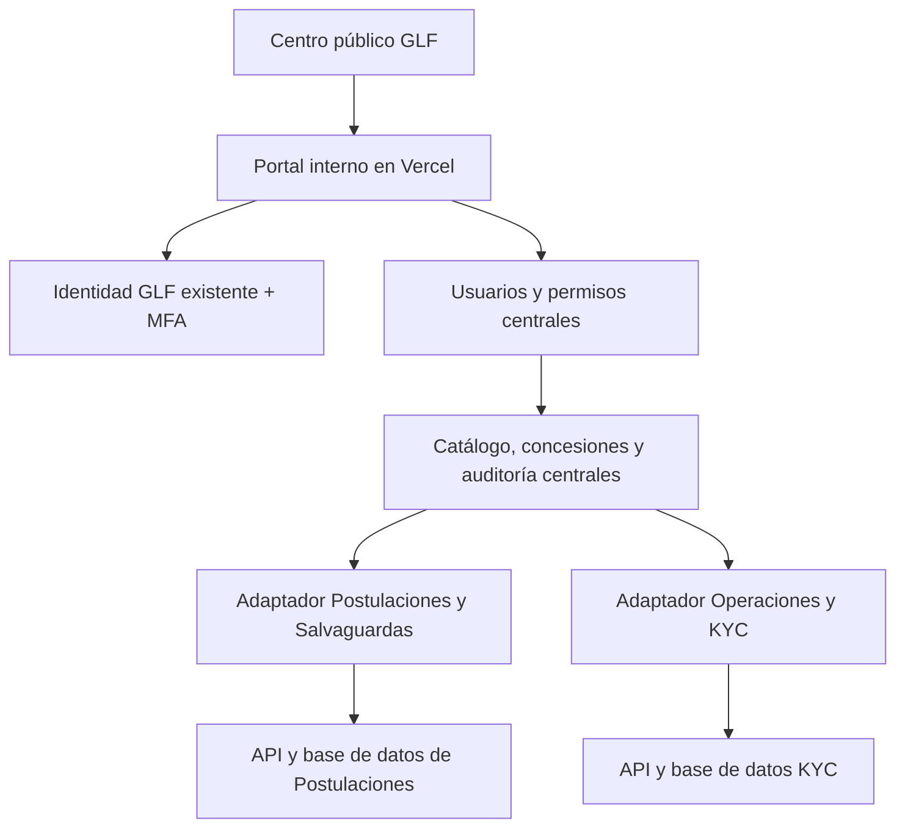

# Portal GLF y administración central de accesos

Fecha: 28 de octubre de 2026. Estado: arquitectura de implementación y primera base de reglas; no conectada todavía a las cuentas reales.

## Decisión

Un portal interno, una identidad y una administración de usuarios para todas las aplicaciones. Las bases de datos de negocio siguen separadas. Cada aplicación aplica los permisos en sus operaciones y archivos, no solo en el menú. La administración técnica no concede por sí misma lectura de expedientes KYC ni capacidad de decidir por otra persona.

No se crean cuentas ni contraseñas nuevas para los quince usuarios incorporados. Se conserva el UUID central, la contraseña, el autenticador y los enlaces de activación emitidos. Las altas externas y los enlaces de formulario KYC mantienen sus rutas propias.

## Evidencia inspeccionada

- `soulkernel/GLF`, main `774caad85e5bf76e4131456f7b2f94ce49badad0`: página estática, un index.html. Es catálogo público; no contiene autenticación ni administración central.
- Postulaciones/Salvaguardas: rama `feat/full-grants-platform`, commit `de7d18bf7be13d0facd02003a251c40708949720`; administra roles y alcances projects/sustainability y emite activaciones de quince días.
- Operaciones/KYC: `src/users-ui.js` administra autorizaciones locales. Su invitación todavía exige una identidad central activa. Sus perfiles se vinculan al UUID del origen de identidad de Salvaguardas mediante Custom OIDC.
- La autorización actual es diferente en ambos sistemas. Ocultar sus dos pantallas no elimina las funciones de administración subyacentes.
- Los archivos README/ACCESO_COMPARTIDO contienen también estados históricos; los contrastes de implementación y el contexto posterior prevalecen sobre los pendientes antiguos.

## Experiencia de uso

1. La página pública conserva aplicaciones y recursos publicados. No muestra usuarios, correos, permisos, expedientes ni enlaces de activación.
2. «Acceso interno GLF» lleva al portal autenticado: correo y contraseña existentes, doble factor, nombre/correo visibles, español/inglés y cierre de sesión.
3. El área interna muestra el catálogo completo de funcionalidades publicadas. Los accesos sin autorización permanecen visibles, deshabilitados y explican «Sin acceso asignado». Los futuros módulos se distinguen como «Próximamente», sin botones operativos.
4. «Usuarios y permisos» muestra usuarios, estado de activación, acceso a cada aplicación y delegaciones. Solo quienes tengan permiso administrativo acceden a sus datos.
5. Alta: buscar correo primero; si existe, reutilizar identidad. Si no, crear invitación central. Elegir un perfil sugerido, aplicaciones y excepciones. Revisar el resumen y guardar. Generar un solo enlace de activación de quince días.
6. El usuario activa una sola cuenta, configura MFA y accede según sus permisos. La creación de identidad, la asignación de permisos y la entrega de correo son estados distintos: no se informa «enviado» al copiar un enlace.
7. Edición: resumen de permisos añadidos/retirados, motivo, vigencia y confirmación. Se conserva historial. No se utiliza una contraseña compartida ni se muestra la del usuario.

## Modelo de permisos comprensible

Jerarquía: Aplicación → Módulo → Fase (cuando exista) → Acción → Ámbito de registros.

Las opciones de lectura, creación, edición, descarga, revisión, aprobación/cierre, desactivación y administración son independientes. «Editar» no equivale a «aprobar», «administrar usuarios» no equivale a leer documentos reservados y «consultar» no implica descargar en bloque. El ámbito indica gobierno/operación GLF, convocatorias asignadas u otros conjuntos explícitamente implementados.

La interfaz ofrece perfiles sugeridos y «Ajustar permisos». Los administradores no deben marcar cientos de casillas para un caso normal. No habrá un «Todo» universal que habilite automáticamente módulos futuros. Un perfil de acceso amplio es un conjunto explícito y versionado de permisos actuales.

Dependencias se muestran al seleccionar: editar requiere consultar; cualquier acción requiere acceso al módulo; una descarga confidencial requiere lectura del expediente. La interfaz explica las dependencias y el servidor las verifica. Un cambio de perfil presenta su diferencia antes de aplicarla.

| Área | Ejemplos de recursos | Acciones separadas | Ámbito |
|---|---|---|---|
| Proveedores | Directorio, especialidades | Consultar, crear, editar, descargar, desactivar | Gobierno, operación GLF o ambos |
| KYC | Expediente, invitación, revisión | Consultar expediente reservado, asistir llenado, invitar, registrar screening, decidir/cerrar, descargar | Ámbito KYC explícitamente concedido |
| Postulaciones | Nota conceptual, propuesta completa | Consultar, observar, editar cuando el flujo lo permita, descargar, decidir | Convocatorias/expedientes asignados y fase |
| Salvaguardas | Screening y revisión A&S | Consultar, revisar, registrar evaluación | Casos asignados y fase |
| Administración | Usuarios, permisos, delegaciones | Invitar, conceder dentro del alcance, suspender, auditar | Institucional o área delegada |

Las filas de Postulaciones/Salvaguardas requieren inventario de cada operación y RLS antes de habilitar casillas granulares. Hoy sus roles no permiten expresar todas las combinaciones. La primera biblioteca de reglas no convierte ni amplía esos roles automáticamente.

### Responsabilidades existentes

Se importan los permisos efectivamente concedidos, sin inferirlos del nombre, cargo ni dominio del correo. Mónica y el administrador de desarrollo conservan sus accesos actuales. Paulina y Ulf mantienen administración limitada a su área, sin poder elevarse ni conceder administración general. Carolina conserva Cumplimiento y la delegación temporal; Dani y Mabel conservan los alcances comerciales aprobados. La consulta de Proveedores para usuarios internos se representa mediante un permiso base explícito, nunca como acceso KYC.

Los responsables pueden delegar solo un subconjunto de su alcance delegable, con inicio y fin. No pueden cambiarse sus propios privilegios ni alterar administradores institucionales. Se impide desactivar al último administrador recuperable. Las ampliaciones propuestas en la nueva matriz no se aplican a personas reales por el simple hecho de crear el catálogo.

## Arquitectura elegida

- Interfaz y backend del portal en Vercel, repositorio `soulkernel/GLF`. El catálogo público actual queda conservado durante la transición.
- Identidad: Supabase Auth central existente. No abrir un tercer proyecto Auth para duplicar usuarios.
- Administración: esquema privado central con catálogo de aplicaciones/recursos/acciones, concesiones, plantillas, delegaciones, operaciones de provisión, estado de integración y auditoría.
- Datos de negocio: permanecen en sus proyectos. El portal no almacena formularios KYC, informes ni documentos de postulantes para poder administrar usuarios.
- Cada aplicación implementa un adaptador: traduce permisos centrales a operaciones concretas, conserva las restricciones de negocio y valida el usuario, MFA, ámbito y vigencia.
- El catálogo y evaluador de esta rama son contratos iniciales. No son un servidor de autorización ni sustituyen RLS; los objetos de sesión y concesiones solo podrán proceder de verificaciones de servidor.

### Identidad y sesión única

Conservar la cuenta compartida es inmediato. Reutilizar una sesión entre dominios requiere integrar OAuth/OIDC: no compartir localStorage, pasar JWT en la URL, copiar cookies ni incrustar aplicaciones privadas en iframes.

Se evaluará OAuth 2.1 Authorization Code + PKCE del origen actual, con clientes privados del GLF, redirecciones exactas, state/nonce y audiencia/cliente permitidos. No activar registro dinámico de clientes públicos. Supabase documenta este servidor como beta: antes de comprometer el despliegue deben pasar pruebas de compatibilidad con los tokens actuales, MFA AAL2, emisor, sub estable, refresh, logout y políticas client_id. Si no pasa, se mantiene temporalmente la misma cuenta con sesiones separadas; no se construye un protocolo de autenticación propio.

### Autorización, revocación y acceso directo

Una administración central no es suficiente si una aplicación sigue aceptando permisos antiguos. La fuente de verdad es central; el registro local es una proyección controlada, no una segunda consola editable.

Durante la transición, los cambios se registran como operaciones versionadas e idempotentes, con resultado por aplicación: pendiente, aplicado o error. No se anuncia éxito total si falla un destino. Una concesión nueva no habilita acceso hasta confirmar el destino; una retirada se prioriza y permanece visible hasta confirmarse. Los reintentos no duplican usuarios ni invitaciones.

Objetivo final: operaciones internas y descargas reservadas pasan por un backend por aplicación que consulta la autorización central vigente y aplica además las reglas locales. Se revocan las rutas de escritura/lectura privada directa del navegador que eludan ese control. El backend usa capacidades de mínimo alcance; no se deposita una clave global service_role de todas las aplicaciones en el portal. La migración incluye RPC, REST, Storage, URLs firmadas, búsquedas y exportaciones.

Si el servicio central no permite confirmar un acceso privado, se deniega temporalmente; el catálogo público sigue disponible. No se promete revocación inmediata basándose solo en JWT hasta su expiración. En la etapa de proyecciones, cualquier demora y acceso aún vigente deben mostrarse al administrador. La implantación completa exige verificar denegación desde API directa con un token anterior y limitar la vida de URLs firmadas. Un documento ya descargado no puede recuperarse al revocar permisos.

La suspensión institucional inhabilita permisos en todas las aplicaciones y revoca sesiones centrales. Suspender solo una aplicación conserva las demás. Cerrar sesión en el portal debe distinguir el cierre local del cierre global hasta que todos los clientes estén integrados.

### Integridad y auditoría

Identificador idempotente por operación, control de versión contra cambios simultáneos y transacciones locales. Una operación distribuida no es una transacción SQL única: se registra cada destino y se reconcilia. Auditoría con actor, destinatario, permisos anteriores/nuevos, motivo, vigencia, fecha y resultado; sin contraseñas, tokens ni contenido de expedientes. No borrar usuarios con historial: suspender y conservar atribución.

## Publicación y ramas

| Componente | Repositorio / base | Rama de trabajo propuesta | Publicación |
|---|---|---|---|
| Portal y administración | soulkernel/GLF, main | feat/portal-accesos-centralizados | Vercel, proyecto propuesto glf-portal; vista previa antes de producción |
| Adaptador de identidad y Postulaciones | Prototipo.Postulacion.Salvaguardas, feat/full-grants-platform | feat/accesos-centralizados | Vercel Preview; conservar URL actual y enlaces emitidos |
| Adaptador Operaciones/KYC | Prototipo.Proveedores.KYC, main | feat/accesos-centralizados | Vercel Preview; conservar URL actual y formulario externo |

Solo la rama del portal se crea en esta primera entrega. Las otras ramas se crearán desde la revisión vigente al comenzar cada adaptador; no se trabaja directamente sobre las ramas publicadas.

Nombre funcional recomendado: «Portal GLF», con «Usuarios y permisos» dentro. Nombre técnico propuesto: glf-portal. La URL glf-portal.vercel.app no está reservada ni publicada por este documento. Cuando GLF disponga del DNS, usar portal.glf.org.ec; no asumir autorización ni disponibilidad del subdominio. GitHub Pages actual sigue disponible y posteriormente dirigirá al nuevo acceso, conservando enlaces P1, P2 y Biblioteca.

## Secuencia de implementación y salida

1. Base aislada: catálogo y reglas probadas, diseño, matriz de equivalencias y registro de decisiones. Sin cambios a cuentas actuales.
2. Administración central de altas: búsqueda de identidad, alta/invitación única, permisos de las dos aplicaciones, seguimiento por destino, MFA y auditoría. Primero cuenta sintética; después importar estados actuales sin reenviar invitaciones ni tocar claves.
3. Integrar permisos en cada operación existente. No mostrar una casilla como disponible hasta que el adaptador la haga cumplir. Migrar todas las rutas antiguas y reemplazar consolas locales por enlaces al mismo centro; sus RPC antiguos deben denegar administración fuera del servicio central.
4. Portal interno y sesión OIDC: validar cuentas activadas y pendientes, recorridos directos y desde portal, revocación, cierre global y recuperación del administrador.
5. Incorporar módulos nuevos mediante catálogo + adaptador + pruebas; añadir una tarjeta por sí sola no convierte otra aplicación en integrada.

La experiencia de alta centralizada puede entregarse antes de completar SSO; ambas capacidades tendrán estados visibles independientes. Esta planificación no necesita que cada usuario repita el registro.

## Criterios obligatorios de aceptación

- Usuario nuevo: una identidad y una invitación; reintento y doble clic no duplican.
- Usuario existente: mismos UUID/contraseña/MFA, sin nueva activación; invitaciones ya emitidas siguen funcionando.
- Una persona puede consultar Proveedores y no obtener ni un metadato de KYC por REST, RPC, archivo o interfaz.
- Permiso en fase 1 no permite escribir en fase 2. Un alcance gobierno no autoriza operación GLF.
- Editar no permite aprobar, y administración técnica no implica lectura de expedientes.
- Delegación caduca en servidor aunque la pantalla permanezca abierta; el delegado no puede redelegar ni ampliar su alcance.
- Responsable de área no puede elevarse, administrar otra área ni modificar al administrador general.
- Suspensión global bloquea también tokens anteriores y enlaces directos de todas las aplicaciones; el resultado por destino es verificable.
- Falla de un destino y concurrencia: estado honesto, reintento idempotente y sin accesos parciales inesperados.
- Aplicantes externos y enlaces KYC no adquieren acceso interno por correo coincidente o por pertenecer al dominio GLF.
- Navegación ES/EN, móvil, teclado, lector de pantalla, menús completos con restricciones y estilos/logo GLF existentes.
- Retroceso de despliegue no restaura permisos revocados; no se reabre una consola local con reglas antiguas.

## Fuentes técnicas consultadas

- https://supabase.com/docs/guides/auth/oauth-server/getting-started (OAuth Server beta y configuración)
- https://supabase.com/docs/guides/auth/oauth-server/oauth-flows (Authorization Code y PKCE)
- https://supabase.com/docs/guides/auth/oauth-server/token-security (aislamiento por cliente y RLS)
- https://supabase.com/docs/guides/auth/third-party/custom-oidc (confianza en emisor externo)
- https://supabase.com/docs/guides/api/custom-claims-and-role-based-access-control-rbac (roles y permisos con RLS)

Las fuentes apoyan mecanismos disponibles; no prueban que los proyectos GLF ya los tengan habilitados ni sustituyen las pruebas de integración.
